:orphan:

Elektronica
########################

Inleiding
-----------------

.. admonition:: info
   :class: margin

   Vind je het concept elektriciteit nog vaag? Lees dit dan even door:   :doc:`Elektrische schakelingen, hoe zat het ook alweer? <HoeZatHetOokalweer>`

Om een robot te maken hoef je niet per se een computertje in de robot te stoppen. 
Door enkel de juiste onderdelen samen te voegen kan je al een robotje maken die rond kan rijden! 
Je kan bijvoorbeeld twee lichtsensoren op de robot monteren die elektriciteit naar 
de motoren sturen als ze een lijn zien. Als je dit op de juiste manier aansluit kan het robotje een lijn volgen!
Dit worden Braitenbergmachines genoemd. Hieronder is zo'n robotje te zien.

.. figure:: https://mirte.org/_nuxt/MIRTE_lite_obstacle_sensor_transparant.Bry8uo3S.png
    :alt: Mirte lite
    :width: 300
    :align: center

    Een MIRTE Lite.

De belangrijkste les die je dit hoofdstuk gaat leren is de volgende: elk elektrische apparaat is uiteindelijk gemaakt 
van veel simpele bouwstenen die op zeer ingenieuze manieren zijn samengevoegd. Zodra je de onderdelen genaamd stroomdraad, weerstandje en transistor 
kent kan je al een gigantisch deel van een elektronisch onderdeel snappen!

In dit hoofdstuk gaan we kijken naar veel voorkomende onderdelen.
Voor dit hoofdstuk is het erg handig wat voorkennis te hebben van elektriciteit. Komen de termen spanning (V), stroomsterkte (A), lading, schakelaren en weerstanden je niet helemaal bekend voor? 
Lees dan vooral het stuk dat hier rechts staat! 

Transistors
-------------------

Bij natuurkunde heb je geleerd over allerlei elektronische onderdelen, waaronder de schakelaar. Uiteraard is het heel handig 
om een schakelaar te hebben die de stroom kan afkappen, maar het is niet handig dat dit altijd handmatig moet gebeuren. 
Gelukkig is er een manier gevonden om de schakelaar te bedienen met een andere stroomdraad! 
Dit wordt een transistor genoemd. Transistoren staan bekend als een van de beste uitvindingen van de afgelopen 100 jaar. 
En niet voor niets: het is een van de meest gebruikte onderdelen in talloze apparaten. Jouw smartphone alleen al heeft 
honderden miljarden transistors (dat is meer dan 100.000.000.000)!

In de figuur hieronder is te zien hoe deze werkt. Er komtvanaf links een draad binnen. Wanneer er een spanning (V) wordt gezet 
op draad A ontstaat er een verbinding tussen het linker- en rechterdeel en kunnen de elektronen verder stromen. Dit kan dus gebruikt worden om de stroom uit te zetten, 
maar het kan ook gebruikt worden om het signaal van A te versterken. A mag namelijk heel zwak zijn om de verbinding te laten ontstaan. Als je de linkerdraad aansluit op een sterke spanningsbron 
kan je een sterk signaal aan de rechterkant laten ontstaan als er een zwak signaal via A binnenkomt. Als A geen signaal binnenbrengt blijft de rechterdraad spanningsloos. 
Hiermee versterk je dus effectief het signaal van A.

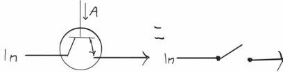

    Een transistor

Binaire getallen
-------------------------
Je hebt misschien al eens gehoord dat computers werken met binaire getallen. Dat betekent dat ze elk getal opslaan als een combinatie van eenen en nullen. Door meerdere van deze naast elkaar te zetten kunnen we grote getallen opschrijven! Het lijkt eigenlijk best wel op onze manier van getallen schrijven, behalve dat wij naast de 1 en 0 ook de cijfers van 2 tot en met 9 gebruiken. Dit heet talstelsel 10. Wanneer je enkel de getallen 0 en 1 gebruikt heet het talstelsel 2 (ook wel binaire getallen of base 2). Een binair cijfer wordt een bit genoemd. 8 bits samen worden een byte genoemd. Een bit is dus 1 of 0, en een byte zou bijvoorbeeld 10110100 kunnen zijn. Computers slaan bits op met behulp van transistoren. Zoals in de vorige paragraaf is uitgelegd kan een transistor een stroom doorlaten of juist niet. Wanneer er een stroom door de transistor loopt noemen we dat een 1, en wanneer er geen stroom doorloopt noemen we dat een 0. Door meerdere van deze transistoren naast elkaar te zetten kunnen we dus grote getallen opslaan!

In het blok hieronder zie je hoe een bepaalde hoeveelheid geschreven kan worden op meerdere manieren. Wij gebruiken dus talstelsel (base) 10, maar je kan ook talstelsel 2 of bijvoorbeeld romeinse cijfers gebruiken! Je hebt dus meerdere manieren om hetzelfde getal te schrijven! Het talstelsel bepaalt alleen maar hoe je een bepaalde hoeveelheid opschrijft, niet hoeveel je van iets hebt.

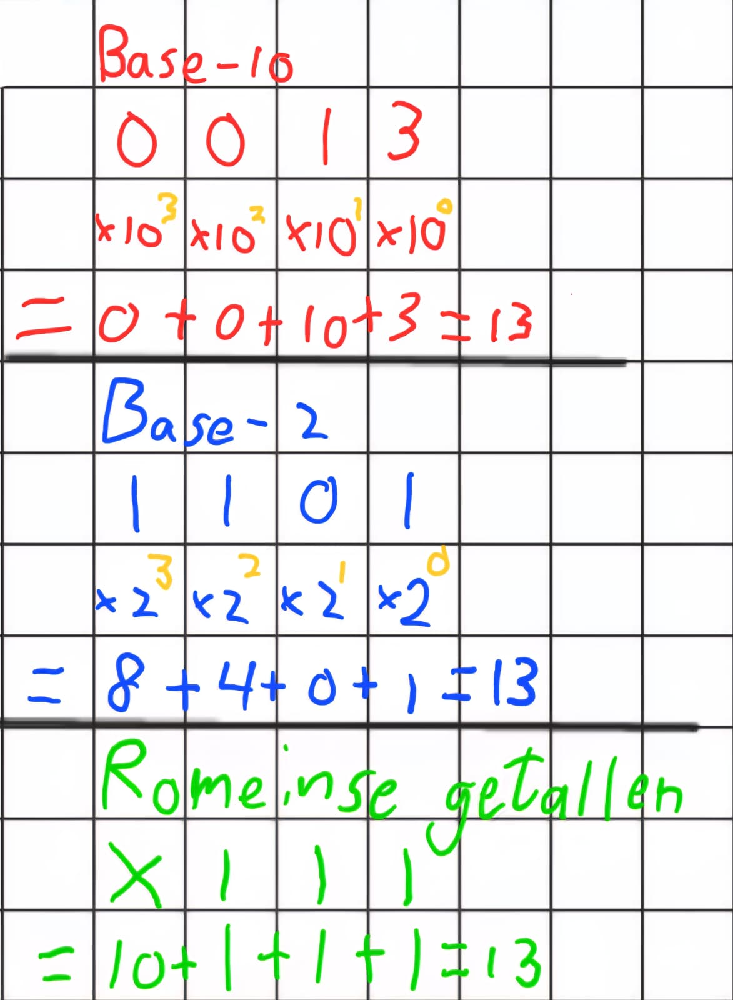

    Manieren om 13 te schrijven TODO SVG erin zetten

In het blok hierboven zie je dat elk getal in de talstelsels een geel bolletje in de linkerbovenhoek heeft. Dit hebben we erbij gezet om het makkelijk te maken om te zien hoeveel elk cijfer waard is. We noemen het meest insignificante cijfer (het meest rechter cijfer) het nulde cijfer, het cijfer links daarvan het eerste cijfer, enzovoort. Bij base 10 is het nulde cijfer 1 waard en elk cijfer daar links van steeds 10 keer meer. Kijk bijvoorbeeld naar 342. Het nulde cijfer voegt :math:`2 \cdot 10^0 = 2 \cdot 1 = 2` aan het totaal toe. Het eerste cijfer (de 4) voegt :math:`4 \cdot 10` toe aan het totaal. Het tweede cijfer voegt :math:`3 \cdot 10 \cdot 10 = 300` toe aan het totaal. 

Bij binaire getallen is het nulde cijfer ook 1 waard. Elk cijfer links daarvan is echter steeds 2 keer zoveel waard in plaats van 10. Kijk bijvoorbeeld naar 1011: het nulde cijfer voegt :math:`1 \cdot 2^0 = 1 \cdot 1 = 1` toe aan het totaal. Het eerste cijfer links daarvan voegt :math:` \cdot 1 \cdot 2^1 = 2` toe aan het totaal. Het tweede cijfer voegt :math:`0 \cdot 2^2 = 0` toe aan het totaal. Het derde cijfer voegt :math:`1 \cdot 2^3 = 8` toe aan het totaal. 1 + 2 + 0 + 8 = 11 dus 11 als binair getal is 1011! 

In het blok hieronder kan je zelf een binair getal maken door op de bits te klikken. Probeer eens om het binaire getal 0101 te maken! Welk hoeveelheid is dat in base 10? Je kan ook proberen om het binaire getal 1111 te maken, dat is het grootste getal dat je met 4 bits kan maken!

|
|

TODO : Bit flipper SVG neerzetten

|
| 
OPDRACHT: Maak de getallen 1 tot en met 15 in het blok hierboven.

Binair optellen
-------------------------

Binaire getallen optellen is niet moeilijker dan getallen vanuit base 10. We gaan kort kijken naar de manier die je in de basisschool geleerd hebt om getallen op te tellen, en passen die dan toe op binaire getallen. Onthoud voor het volgende deel dat het meest rechter cijfer het nulde cijfer genoemd wordt, het cijfer links daarvan het eerste, enzovoort.

Wanneer je bijvoorbeeld de getallen 17 en 29 wil optellen (in base 10) kan je eerst met de nulde getallen berekenen dat 7 + 9 gelijk is aan 16. Je schrijft de 6 op als nulde cijfer van het antwoord en onthoudt de 1. Om het eerste cijfer uit te rekenen doe je 1 + 2 (van 17 en 29) + 1 (die je onthield) = 4. Je schrijft de 4 op als eerste cijfer en je hebt het antwoord: 46. Dit is uiteraard kinderspel. In het blok hieronder kan je nog een keer kijken hoe de stappen eruit zien voor bijvoorbeeld 517 + 845.

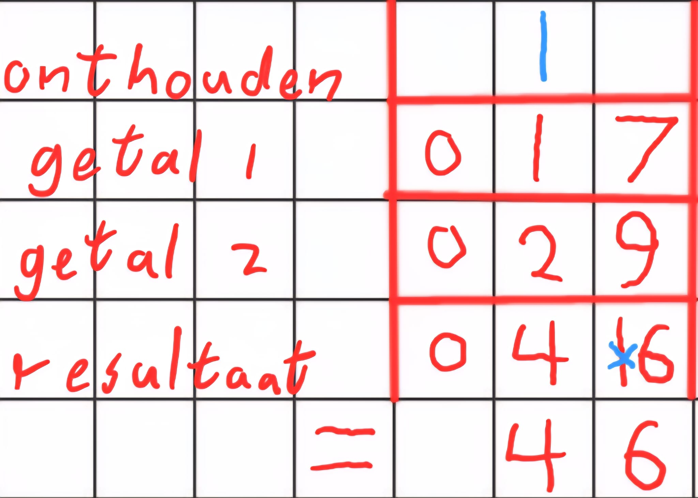

    17 + 29 optellen in base 10 TODO SVG ERIN ZETTEN

Zoals hierboven gezegd, kan optellen bij binaire getallen met exact dezelfde stappen gedaan worden. Kijk maar naar de stappen in het blok hieronder:
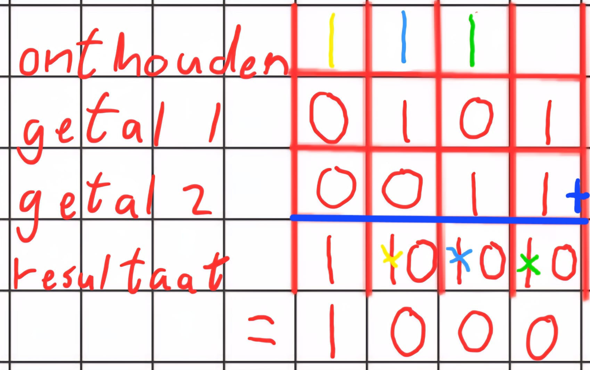

    5 + 3 optellen in base 2 TODO SVG ERIN ZETTEN

OPDRACHT 2

In deze opdracht gaan we oefenen met het omschrijven van getallen tussen base 2 en base 10, en het optellen van binaire getallen.

a) Schrijf de volgende getallen op in base 2: 0, 1, 2, 3, 5, 6, 11, 16.

b) Reken de som van 10 en 111 (base 2) uit in base 2. Volg voor deze vraag dezelfde stappen als in het blok hierboven.

c) Zet de getallen 10 en 111 (base 2) om naar base 10.

d) Tel deze getallen bij elkaar op in base 10 en zet het antwoord weer om naar base 2. Is het antwoord hetzelfde als bij vraag b?

d) Reken de som van 1011 en 1001 (base 2) uit in base 2 en zet het om antwoord om naar base 10.

Logica
-----------------------------------------

Je kan nu dus binaire getallen opslaan en optellen. Maar hoe kan je een computer nu zelfstandig laten rekenen met deze getallen? Zouden we zelf door de juiste onderdelen aan elkaar te koppelen zelf een optelmachine kunnen maken? Dat is zeker mogelijk! We gaan kijken naar hoe we dit kunnen doen met behulp van wiskundige machines.

Wiskundige machines zijn onderdelen die een bepaalde wiskundige bewerking uitvoeren. Er is een ingangssignaal dat de machine binnenkomt, en een uitgangssignaal dat de machine teruggeeft. Zo'n signaal kan bijvoorbeeld een bit (1 of 0) zijn. Een optelmachine zou er als volgt uit kunnen zien:

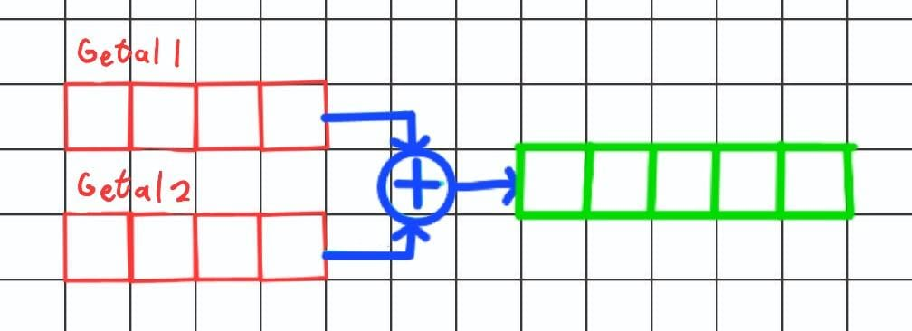

    Optelmachine TODO SVG ERIN ZETTEN (base 2 variant)

Als deze machine met elektronica zou bestaan, zou het ingangssignaal een draadje zijn waar eventueel spanning op staat. Als er spanning op staat, leest de machine het als een '1', anders als een '0'. Het is echter nog maar de vraag hoe je de binnenkant zou moeten maken. Een optelmachine doet namelijk al best een complexe taak. Om dit soort complexe machines te maken gebruik je vaak een aantal kleinere machines die aan elkaar verbonden zijn. Deze gedragen zich als geheel dan zoals een optelmachine. 

Een belangrijke group van die kleinere machines zijn de logische poorten (*logic gates*). Dit zijn machines die 1 simpele logische denkstap kunnen uitvoeren. De meest simpele poorten zijn de en-machine, of-machine en niet-machine. Deze machines krijgen 1 of 2 binaire getallen binnen, en geven een binaire waarde terug die afhankelijk is van de input. Om het gedrag van zo'n poort weer te geven, worden waarheidstabellen gebruikt. Dit zijn tabellen die op elke rij een mogelijk inputsignaal en het bijbehorende outputsignaal hebben staan.

Laten we dit bekijken met een voorbeeld: de niet-machine. Deze machine krijgt 1 waarde binnen (deze noemen we A) en geeft het tegenovergestelde terug (niet A). De waarheidstabel van deze machine is als volgt:

============= =================
niet-machine
-------------------------------
A (ingang)    niet A (uitgang)
============= =================
0             1       
1             0     
============= =================

De reden dat een waarheidstabel zo heet is omdat de 1 en 0 geïnterpreteerd kunnen worden als 'waar' en 'onwaar'. Je kan de tabel ook met deze woorden maken.

============= =================
niet-machine
-------------------------------
A (ingang)    niet A (uitgang)
============= =================
Onwaar        Waar       
Waar          Onwaar  
============= =================

In de waarheidstabel van de niet-machine zie je dat wanneer A "onwaar" is, de output "waar" is, en wanneer A "waar" is, de output "onwaar" is.
In een waarheidstabel staan op elke rij (horizontaal) waardes die allemaal tegelijk kunnen voorkomen. Je komt dus nooit een rij tegen waar A "waar" is en "niet A" ook waar is!

De tweede machine waar we naar gaan kijken is de en-machine. Deze krijgt twee waardes gegeven (A en B), en de vraag 'Zijn A en B waar' geeft. Het geeft dus de waarde "waar" terug als A en B "waar" zijn, en anders "onwaar". De waarheidstabel van deze machine is als volgt:

=========== =========== ===========
en-machine                        
-----------------------------------
A           B           A en B    
=========== =========== ===========
Onwaar      Onwaar      Onwaar    
Onwaar      Waar        Onwaar    
Waar        Onwaar      Onwaar    
Waar        Waar        Waar      
=========== =========== ===========

Ten slotte kijken we naar de of-machine. Deze machine geeft antwoord op de vraag "Is A of B waar?" Deze geeft "waar" terug als ten minste 1 van de 2 gegeven waardes "waar" is (dus ook als beide waardes waar zijn). Daar hoort de volgende waarheidstabel bij:

=========== =========== ===========
of-machine                        
-----------------------------------
A           B           A of B    
=========== =========== ===========
Onwaar      Onwaar      Onwaar    
Onwaar      Waar        Waar      
Waar        Onwaar      Waar      
Waar        Waar        Waar      
=========== =========== ===========

We hebben nu de 3 basismachines gezien.

Hiermee kunnen we dus een bit (een 1 of een 0) krijgen door een of twee bits aan de machine te leveren. Door deze machines aan elkaar te koppelen kunnen we 
steeds complexere onderdelen maken. Stel dat je het resultaat van een en-machine ook nog door de niet-machine zou leiden: Je krijgt dan enkel "onwaar" als output wanneer beide inputs 
"waar" zijn. Het geeft dan dus antwoord op de vraag "Zijn niet beide inputs Waar?". Let op: dit is niet gelijk aan de vraag "Zijn beide inputs niet waar?". Dit kan je nagaan door de waarheidstabel van beide vragen op te stellen. 

=========== =========== =========== ===========
A           B           Niet beide  Beide niet        
=========== =========== =========== ===========
Onwaar      Onwaar      Waar        Waar    
Onwaar      Waar        Waar        Onwaar      
Waar        Onwaar      Waar        Onwaar      
Waar        Waar        Onwaar      Onwaar      
=========== =========== =========== ===========

Door de outputs van een van deze machines als inputs te gebruiken als input voor een andere van deze machines kunnen we dus complexere machines maken. 
De meest gebruikte variant hiervan is misschien wel de exclusieve-of-machine.
Deze geeft "waar" terug als enkel de eerste of enkel de tweede waarde "waar" is. Wanneer beide waardes "waar" zijn is het resultaat dus "onwaar". 
In het engels wordt in plaats van de term "exclusieve of" de term "xor" gebruikt. De waarheidstabel van deze machine is als volgt:

============ ============ ============
xor-machine                       
--------------------------------------
A            B            A xor B   
============ ============ ============
Onwaar       Onwaar       Onwaar    
Onwaar       Waar         Waar      
Waar         Onwaar       Waar      
Waar         Waar         Onwaar    
============ ============ ============

In de context van elektronica komen de waardes van "waar" en "onwaar" overeen met of er spanning (V) op een kabeltje staat.
We kunnen bijvoorbeeld zeggen dat "waar" overeenkomt met 5V en "onwaar" overeenkomt met 0V. Nou is het echter zo dat in de 
werkelijkheid spanning altijd een beetje fluctueert. Daarom is het handiger om te zeggen dat "waar" overeenkomt met een spanning van 2.5 volt of hoger, en "onwaar" overeenkomt met een spanning van lager dan 2,5 volt.  
In de figuur hieronder zie je een signaal die van "waar" (1) naar "onwaar" (0) gaat en weer terug. 

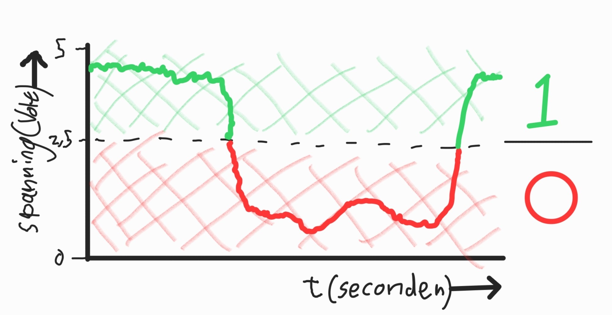

    Signaal dat van "waar" naar "onwaar" gaat en weer terug.

Wiskundige machines bouwen
---------------------------
Om een computer te maken die kan rekenen moeten we een samenstelling van onderdeeltjes vinden die in de basis de volgende twee dingen kan: 

1. Getallen opslaan.
2. Simpele logische stappen zetten.

Met deze twee acties kunnen we al veel bereiken! Door simpele logische machines aan elkaar te koppelen kunnen we ook complexe problemen oplossen.

Om aan punt 1 te voldoen kunnen we een getal opslaan door een aantal bits naast elkaar te zetten. Elk bit kan 0 of 1 zijn, dus door meerdere bits naast elkaar te zetten kunnen we grote getallen opslaan. 
Zoals eerder gezegd, bestaat zo'n bit uit een draadje waar ofwel spanning op staat (1) ofwel geen spanning (0). Door meerdere van deze draadjes naast elkaar te zetten kunnen we grote getallen opslaan.

Om aan punt 2 te voldoen heeft een computer bijvoorbeeld onderdelen nodig die twee getallen kunnen optellen of vermenigvuldigen. Deze zijn vaak gemaakt door meerdere logische machines zoals hierboven aan elkaar te koppelen. Nu is de vraag echter: hoe maak je een logiche poort met elektronische onderdelen? We gaan kijken naar circuits die als wiskundige machines werken. 

Hieronder zie je hoe je bijvoorbeeld een en-poort maakt. Het circuit maakt gebruik van een serieschakeling. Zoals je weet, loopt er bij een serieschakeling geen stroom als er een schakelaar open staat. Omdat de input waardes beiden een schakelaar openzetten (transistor uitzetten) wanneer ze "onwaar" zijn, zal er alleen stroom lopen als beide inputs "waar" zijn. Door spanning te zetten op draden A en B kan je stroom laten lopen. Wanneer er spanning staat op zowel A als B, zal het lampje gaan branden en komt er spanning te staan op draad C. 

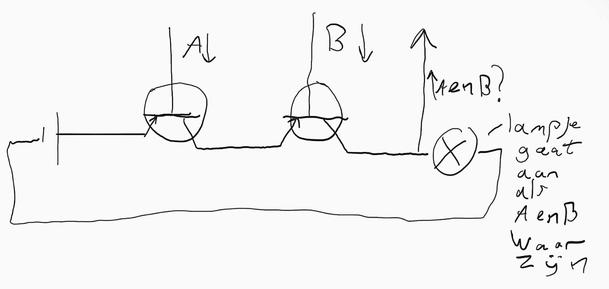

    Voorbeeld van een elektronische en-poort.

De of-poort lijkt erg op de en-poort, maar de transistoren worden nu in parallel gezet in plaats van in serie. Dit zorgt ervoor wanneer er ook maar 
1 transistor is geactiveerd, het signaal al door wordt gegeven! Als beide inputs 'waar' zijn wordt het signaal ook doorgegeven.

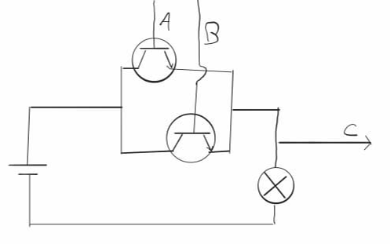

    Voorbeeld van een elektronische of-poort.

.. admonition:: info
   :class: margin

   Wil je weten hoe je de niet-machine en xor-machine daadwerkelijk maakt als circuit? Lees dan dit stukje:   :doc:`Hoe maak je poorten? <LogicaPoorten>`

**TODO propositielogica toevoegen?**

Stel nu dat we twee getallen hebben opgeslagen, beide met 1 bit (dus gelijk aan 0 of 1). 
Hoe kunnen we dan deze getallen optellen? Dit doen we door de juiste logische poort(en) te gebruiken op de bits. De optelmachine zou er als volgt uitzien:

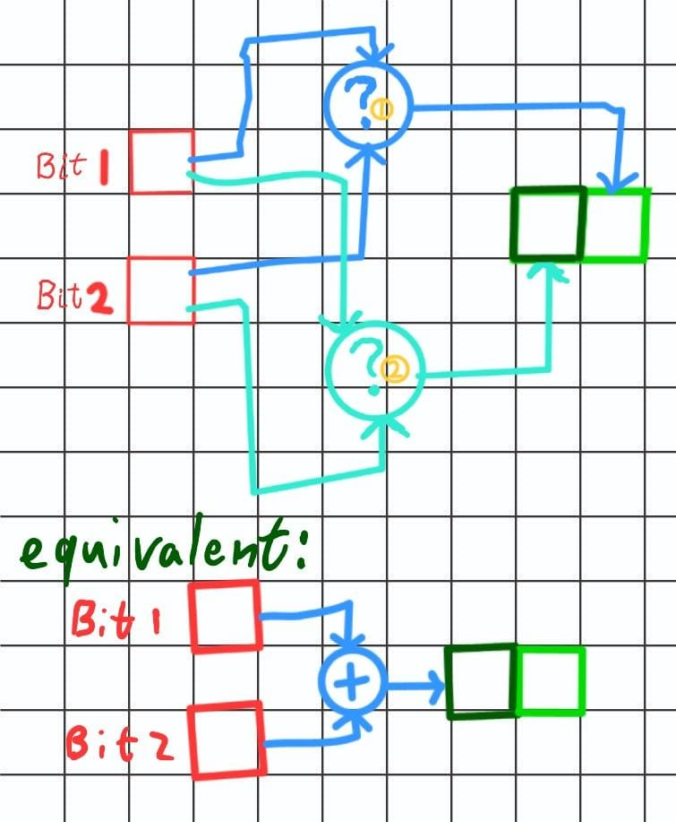

    Optelmachine voor 2 bits  **TODO de simpele versie bovenop zetten**

Hierbij zijn de twee vraagtekens logische poorten. Nu moeten we enkel nog uitzoeken welke dan precies. Dit ga je in de komende opdracht doen!

**Opdracht 1**
    
We willen bepalen welke poorten we nodig hebben om de som van 2 bits te berekenen. We hebben dus twee cijfers die ofwel 0 ofwel 1 gaan zijn 
en willen weten hoe we het resultaat kunnen berekenen. 

a. Wat zijn alle antwoorden die mogelijk zijn?
    Gebruik eventueel het diagram als basis. Schrijf de mogelijke antwoorden op in base 2:

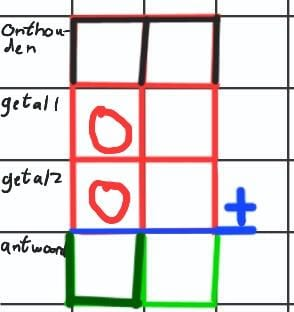

| 0 + 0 = ? (base 2) 
| 0 + 1 = ? (base 2) 
| 1 + 0 = ? (base 2) 
| 1 + 1 = ? (base 2) 

b. Hoeveel bits heb je nodig zodat elk mogelijke antwoord opgeslagen kan worden?
    Tip: Met 1 bit kan je alleen 0 en 1 opschrijven, terwijl je met 8 bits bijvoorbeeld al de getallen 0 tot en met 255 kan opslaan.

d. Vul in de eerste tabel hieronder de som in van elke combinatie van 1 en 0. Vul vervolgens de juiste waardes in in de twee waarheidstabellen die overeenkomen met de twee vraagtekens.

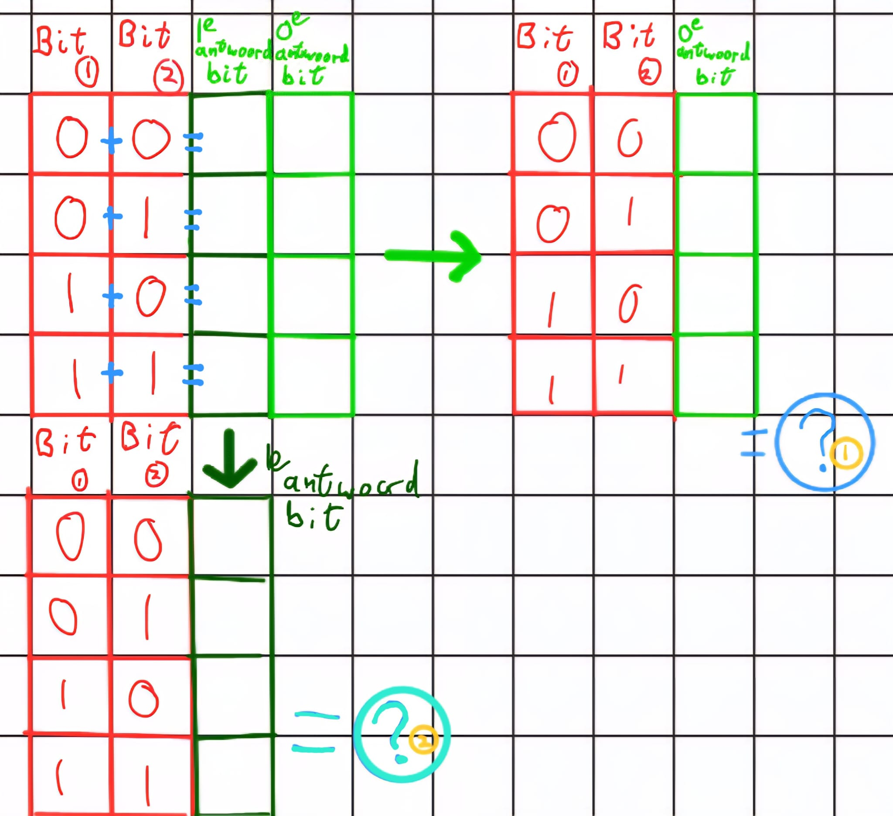

    Waarheidstabellen

**TODO: IPV de tabel linksboven als tabel weer te geven meer focussen op dat het 4 optelsommen zijn, en dan grafische weergeven welke rij je waar neer moet 
zetten om de 2 waarheidstabellen te krijgen** 

e. De twee waarheidstabellen die bij de vraagtekens horen zijn als het goed is gelijk aan een van de bovenstaande tabellen van de bestaande poorten! Welke poorten zijn dat?

Als je weet hoe je de 2 poorten van hierboven moet bouwen, kan je nu dus ook een onderdeeltje bouwen die 2 bits kan optellen! Door dit 
soort systemen aan elkaar te koppelen op steeds grotere schaal kan je complexe machines maken!

Modules
-----------------------------------------

Door logische poorten en losse onderdeeltjes zoals weerstanden aan elkaar te schakelen kunnen we modules maken. 
Modules zijn een brede term voor onderdelen 
die een specifieke taak kunnen uitvoeren binnen je stroomnetwerk. 
Een simpele variant hiervan is een H-brug. Dit wordt gebruikt om de stroomrichting door een draad 
om te kunnen keren. In het plaatje hieronder zie je een motor M met daaromheen de H-brug. Zoals je ziet kunnen 
we kiezen aan welke kant de stroom binnenkomt en aan welke kant de stroom weggaat: We kunnen schakelaars s1 en s4 OF schakelaars s2 en s3 tegelijk sluiten 
om de stroomrichting te kiezen. We kunnen de draairichting van een motor hiermee omdraaien! 

.. figure:: https://upload.wikimedia.org/wikipedia/commons/thumb/d/d4/H_bridge.svg/960px-H_bridge.svg.png
    :alt: Een H-brug
    :width: 300
    :align: center

    Een H-brug (COPYRIGHT?)

Een andere module die veel voorkomt is een *analog to digital converter* (ADC). Dit is 
een onderdeel die een analoog signaal kan vertalen naar een digitale binaire waarde. Er is namelijk een probleem 
als je bijvoorbeeld een temperatuursensor wil aflezen met je computer. De sensor geeft een bepaalde spanning (V) door via de verbindingskabel, die overeenkomt met een bepaalde temperatuur aan 
de hand van een formule die bij de sensor hoort. De computer kan niet direct de spanning opslaan 
om mee te rekenen. Het moet de spanning omzetten naar een binair getal die deze spanning uitdrukt in volt. 
Het onderdeel die deze omzetting kan doen is dus de AD converter. Je hebt ook een *digital to analog converter* (DAC). Deze 
doet dezelfde taak, maar dan andersom. Dit wordt bijvoorbeeld gebruikt om de digitale muziek van je computer om te zetten naar een analoog signaal voor speakers.

.. figure:: https://www.embedded.com/wp-content/uploads/sites/2/2025/01/Figure-1.png
    :alt: Een AD en DA converter
    :width: 300
    :align: center

    Een ADC en een DAC (COPYRIGHT?)

Tegenwoordig hebben de meeste apparaten ook een module die veel geavanceerder is dan een simpel weerstandje of transistor: een rekenchip. 
Met zo'n chip kan je lastige berekeningen uitvoeren en allerlei dingen aansturen. Een voorbeeld van zo'n chip is een 
*CPU* (central processing unit). Een goeie analogie van een *CPU* is 10 professoren. Een *CPU* kan een aantal lastige 
berekeningen tegelijkertijd uitvoeren. Voor veel taken is het echter handig om veel meer mensen te hebben die wat minder goed zijn in rekenen. Denk bijvoorbeeld 
aan het creeeren van het beeld dat je op je scherm ziet. Op je scherm moeten er miljoenen pixels een kleur krijgen, en dat tientallen keren per seconde! Dit is per 
pixel geen moeilijke taak, maar het is wel een gigantische hoeveelheid werk. Daarom hebben we ook *GPU's* (graphics processing units). Deze zijn gemaakt om veel simpele taken tegelijk uit te voeren.
Omdat *CPU's* en *GPU's* zo breed toepasbaar zijn, verliezen ze wel wat snelheid. Een directe schakeling van logica poorten die precies 
de rekensom uitvoert die je nodig hebt zal altijd sneller zijn dan een *CPU* of *GPU* die een programma draait dat deze rekensom uitvoert. Daarom hebben we ook nog *FPGA's* (field programmable gate arrays). 
Deze kunnen ook geprogrammeerd worden om allerlei berekeningen te doen, maar deze creeërt een fysieke schakeling van de juiste logische poorten 
om de berekening uit te voeren. Hierdoor is het sneller dan een *CPU* of *GPU*, maar ook veel minder flexibel. Daarnaast zijn ze vaak ook erg duur.

.. figure:: https://asset.conrad.com/media10/isa/160267/c1/-/nl/1172623_BB_00_FB/image.jpg
    :alt: microcontroller
    :width: 300
    :align: center

    Een microcontroller (COPYRIGHT?)

Het is voor een robot erg belangrijk om snel te kunnen reageren op gebeurtenissen. Je wil bijvoorbeeld dat de robot meteen een bocht maakt als hij een muur ziet.
Voor deze reden wordt meestal een *microcontroller* gebruikt in een robot. Deze is minder krachtig dan een CPU, maar is wel erg snel en zuinig met energie. Daarnaast zijn ze vaak 
ook erg goedkoop. Een microcontroller is heel nauw verbonden met de hardware van een robot. Dit zorgt voor een hele lage vertraging tussen het moment dat er een sensor een signaal geeft en het moment dat de microcontroller hierop reageert.
Je kan er programmeercode op zetten om allerlei andere onderdelen aan te sturen. 
Je zou bijvoorbeeld kunnen programmeren dat wanneer er spanning (V) staat op twee aangesloten stroomdraden, er ook spanning moet 
worden gezet op een derde uitgaande stroomdraad. Je hebt dan een *en-poort* gemaakt! Een microcontroller kan nog veel complexere taken 
uitvoeren dan dat. 

**TODO CPU ENZO BETER UITLEGGEN, TABEL TOEVOEGEN**